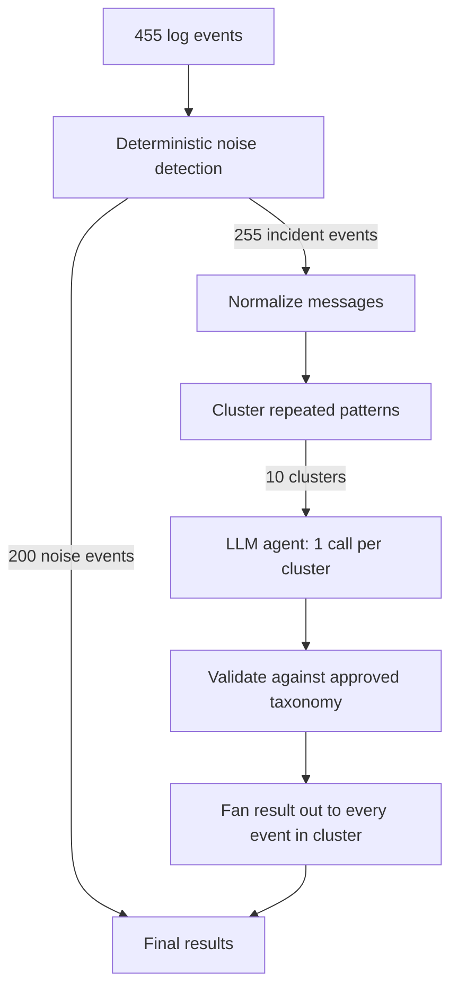

# TriageOps: LLM Incident Triage Agent

Classify infrastructure log events, find the root cause and pick an approved remediation, while sending **97.8% fewer requests to the LLM**.

TriageOps combines deterministic pre-processing with a structured-output LLM agent. Noise is filtered locally, repeated incident patterns are clustered, and only one representative event per cluster is sent to the agent. Remediations are restricted to a fixed approved set, so the model cannot invent actions.

| | |
|---|---|
| **Events processed** | 455 (full dataset) |
| **LLM calls** | 455 → 10 (97.8% reduction) |
| **Cost reduction** | 97.7% vs. naive baseline |
| **Fabricated remediations / false escalations** | 0 / 0 |

---

## Why this exists

Sending every log line to an LLM works, but it is slow and expensive, and most of the work is redundant:

- Some events are known noise that needs no reasoning.
- Many incident events are repeats of the same underlying problem.
- Remediation output must stay inside an approved set to be safe to act on.

TriageOps answers four questions for each event: *Is it a real incident? What category? What root cause? Which approved remediation?* It does this with as little LLM work as possible.

## Architecture



| Stage | What it does |
|---|---|
| **Noise detection** | Known non-actionable patterns are handled with local Python logic. No LLM call. |
| **Normalization** | Variable values (durations, counts, ports, IDs) are masked, so *"timeout after 30 s"* and *"timeout after 60 s"* become the same pattern. |
| **Clustering** | Remaining incident events are grouped into clusters of the same pattern. |
| **Agent call** | One representative event per cluster is classified by the LLM agent. |
| **Validation** | Output is checked against the output contract and approved taxonomy before use. |
| **Fan-out** | The validated result is applied to every event in its cluster, so all 455 events are covered. |

## Agent output

The agent returns structured JSON:

```json
{
  "is_incident": true,
  "category": "capacity",
  "root_cause": "rate_limit_breach",
  "remediation": "add_backpressure_and_request_quota_increase",
  "confidence": 0.99
}
```

For the input `service=search-api severity=ERROR message="rate limit exceeded: 429 from search-index, 12k req/min > 10k quota"`.

### Keeping classifications consistent

Giving the model three independent lists (category, root cause, remediation) allowed combinations that were individually valid but wrongly related. The agent instructions now define explicit root-cause-to-category mappings, for example:

| Root cause | Category |
|---|---|
| `memory_leak`, `disk_full` | `resource_exhaustion` |
| `rate_limit_breach`, `consumer_lag` | `capacity` |
| `db_connection_pool_exhausted`, `upstream_outage` | `dependency_failure` |
| `db_deadlock`, `null_pointer` | `code_defect` |
| `missing_index` | `performance` |
| `expired_cert` | `config_error` |

## Results

Benchmarked against a naive baseline that sends every event to the agent.

| Metric | Naive | Optimized |
|---|---:|---:|
| Events processed | 455 | 455 |
| LLM calls | 455 | **10** |
| Call reduction | n/a | **97.8%** |
| Cost reduction | baseline | **97.7%** |
| Category macro-F1 | 1.000 | 1.000 |
| Root-cause accuracy | 1.000 | 1.000 |
| Fabricated remediations | 0 | 0 |
| False escalations | 0 | 0 |
| p95 latency | 3.91 s | 4.29 s |

Accuracy metrics are computed on the labeled subset of the dataset ([N] events).

## Limitations and next steps

- **Latency:** optimized p95 latency (4.29 s) is higher than the naive run (3.91 s). Prompt shortening, taxonomy changes and model/configuration comparisons were tried, but further tuning was not completed.
- **Cluster fan-out:** applying one result to a whole cluster assumes normalization groups only truly equivalent events. An outlier inside a cluster would inherit the representative's label. Sampling more than one event per cluster, or checking confidence, would reduce this risk.
- **Evaluation scope:** perfect scores were measured on a small, structured, labeled dataset. They are not a claim about production traffic.
- **Next steps:** latency tuning, per-cluster confidence checks, and a larger and more varied evaluation set.

## Project structure

```text
triageops-llm-incident-agent/
├── README.md
├── data/
│   └── sample_logs.csv          # 455 log events
├── harness/
│   ├── main.py                  # pipeline + benchmark runner
│   ├── requirements.txt
│   └── README.md
└── docs/
    ├── results.md               # full benchmark results
    ├── agent_setup.md           # agent role, instructions, taxonomy, output format
    └── design_notes.md          # optimization decisions and latency investigation
```

## Getting started

**Requirements:** Python 3.9+ and a Lyzr Agent Studio account with a configured agent (see [`docs/agent_setup.md`](docs/agent_setup.md)).

```bash
git clone https://github.com/manojsambana443/triageops-llm-incident-agent.git
cd triageops-llm-incident-agent/harness

python -m venv .venv
source .venv/bin/activate        # Windows: .\.venv\Scripts\Activate.ps1
pip install -r requirements.txt
```

Set your credentials as environment variables (never commit them):

```bash
export LYZR_API_KEY="your-api-key"
export LYZR_AGENT_ID="your-agent-id"
export LYZR_USER_ID="your-user-id"
```

Run a quick smoke test on 20 events, then the full dataset:

```bash
python main.py --data ../data/sample_logs.csv --limit 20
python main.py --data ../data/sample_logs.csv
```

## Live demo

The triage agent is deployed in Lyzr Agent Studio. Paste a log event (service, severity, message) to see the structured classification:
[Open the live agent](https://studio.lyzr.ai/create-new-agent/6a856488c45a2577ece296ca?tab=playground&public=true)

## Tech stack

Python · Lyzr Agent Studio · structured LLM output · deterministic pre-processing and clustering
